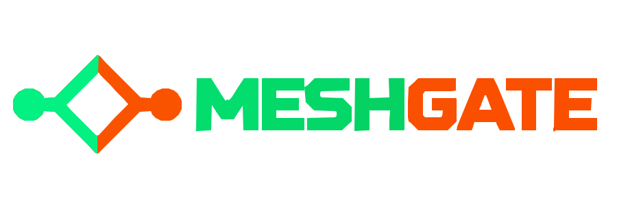
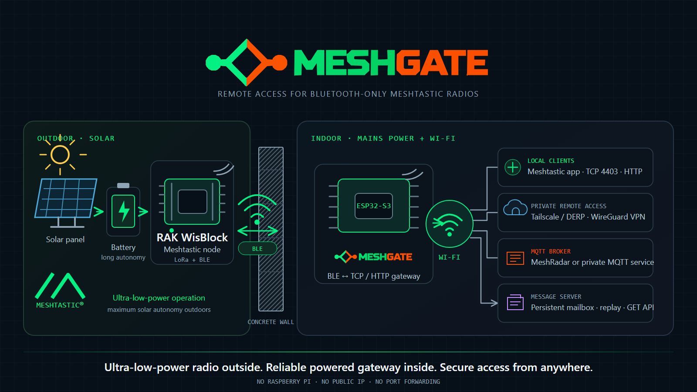
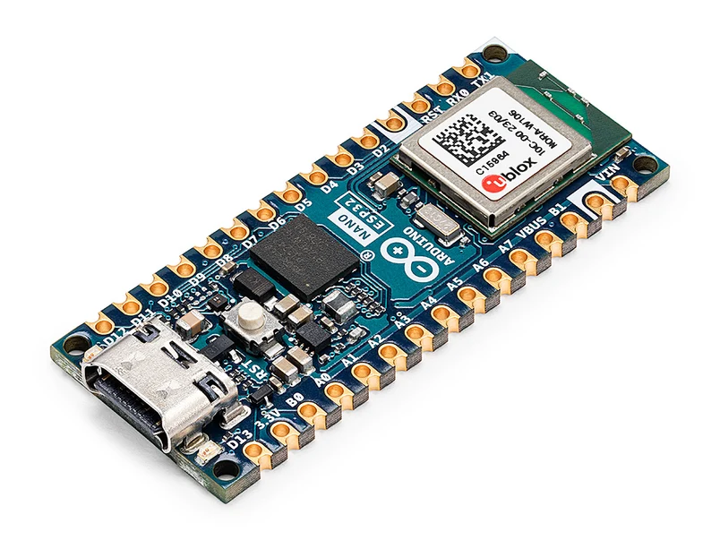

<p align="center">
  
</p>

<p align="center"><strong>Remote administration for Bluetooth-only Meshtastic radios, built on ESP32.</strong></p>



[](https://flagcounter.me/details/kOa)

MeshGate connects to a Meshtastic radio over BLE and exposes the native
Meshtastic PhoneAPI on TCP port `4403` and through the standard HTTP endpoints
used by browser clients. On the local network it behaves like a Wi-Fi-capable
Meshtastic node. On the ESP-IDF 5 production build it can also
join Tailscale directly, so the same node remains reachable through carrier
NAT, changing public IP addresses and networks without port forwarding or a
Raspberry Pi.

The firmware includes a self-contained setup portal, authenticated OTA,
redundant configuration storage, remote logs, watchdog recovery, scheduled
maintenance restarts, a persistent offline message mailbox, MQTT proxying,
classic WireGuard, Prometheus metrics and an RGB IP-address indicator.

## Contents

- [Why this fork exists](#why-this-fork-exists)
- [Data path](#data-path)
- [Supported build targets](#supported-build-targets)
- [Install](#install)
- [First-time setup](#first-time-setup)
- [Tailscale remote access](#tailscale-remote-access)
- [MQTT gateway](#mqtt-gateway)
- [Operations and recovery](#operations-and-recovery)
- [Technical changelog](CHANGELOG.md)
- [Documentation](#documentation)
- [Verified result](#verified-result)
- [Security](#security)
- [Credits and license](#credits-and-license)
- [Contact](#contact)

### Recommended and tested hardware

[](https://link.amazon/B0bHRPLPo)

**Arduino Nano ESP32 (ESP32-S3, without headers)** is the recommended board and the production firmware, native Tailscale and one-click OTA path are tested on it.

**[Buy the tested board on Amazon](https://link.amazon/B0bHRPLPo)** · **[Install MeshGate in the Web Flasher](https://p1337.github.io/meshgate/)**

> [!IMPORTANT]
> MeshGate is a source fork of
> [SourceLabOrg/meshtastic-esp32-bt-bridge](https://github.com/SourceLabOrg/meshtastic-esp32-bt-bridge).
> This repository was created independently rather than with GitHub's Fork
> button, so GitHub may not display the usual fork-network banner. Upstream's
> MIT license and authorship are preserved.

## Why this fork exists

The upstream bridge solves local BLE-to-TCP access. MeshGate extends that idea
for an unattended remote site:

- a production ESP-IDF 5 port using Arduino Core 3.3.9, ESP-IDF 5.5.4 and
  NimBLE-Arduino 2.5.2;
- native Tailscale through [MicroLink](https://github.com/kaieda/microlink),
  including DERP relay support for mobile clients behind carrier NAT;
- correct lwIP core-thread delivery for decrypted WireGuard packets;
- verified DERP fallback until a direct UDP path has actually been proven;
- authenticated dual-slot OTA and remote diagnostics;
- redundant NVS configuration, task watchdogs and timed recovery restarts;
- BLE address recovery when an nRF52 radio rotates its private address;
- a radio-managed MQTT proxy and OpenMetrics/Prometheus telemetry;
- a dark control interface inspired by the visual language of MeshRadar.

The implementation-level comparison is maintained in
[docs/upstream-differences.md](docs/upstream-differences.md).

## Data path

```text
Meshtastic radio
      │ BLE GATT (encrypted, 6-digit pairing)
      ▼
MeshGate on ESP32 ───── Wi-Fi LAN ───── TCP 4403 ───── Meshtastic app
      │
      ├── HTTP /api/v1/{to,from}radio ─ browser-based Meshtastic client
      ├── flash mailbox ─────────────── retained chat replay + JSON GET API
      ├── Tailscale / DERP ──────────── remote TCP 4403 + HTTP + Web UI + OTA
      ├── optional classic WireGuard
      └── optional MQTT proxy ───────── radio-selected MQTT broker
```

MeshGate transports the original Meshtastic protobuf stream. It does not
replace the Meshtastic protocol, decrypt private channels, or invent another
application API.

## Supported build targets

| PlatformIO environment | Hardware | Runtime | Tailscale | Role |
| --- | --- | --- | --- | --- |
| `arduino_nano_esp32_idf5` | Arduino Nano ESP32 (ESP32-S3) | Arduino Core 3.3.9 / ESP-IDF 5.5.4 | Yes | Production remote gateway |
| `arduino_nano_esp32` | Arduino Nano ESP32 (ESP32-S3) | Arduino Core 2.0.17 / ESP-IDF 4.4.7 | No | Proven recovery image |
| `seeed_xiao_esp32s3` | Seeed XIAO ESP32-S3 | Arduino Core 2.x / ESP-IDF 4.4 | No | Compact local gateway |
| `esp32-s3-devkitc-1` | Generic ESP32-S3 DevKitC | Arduino Core 2.x / ESP-IDF 4.4 | No | Generic S3 target |
| `esp32dev` | ESP32-WROOM / NodeMCU | Arduino Core 2.x / ESP-IDF 4.4 | No | Classic ESP32 target |

ESP32-S2 is not supported because it has no Bluetooth radio. Native Tailscale
is currently scoped to the `arduino_nano_esp32_idf5` production environment;
the remaining platforms still provide local TCP, MQTT proxying, OTA and
classic WireGuard.

## Install

Use the [MeshGate Web Flasher](https://p1337.github.io/meshgate/) in Chrome,
Edge or Opera on a desktop computer, or download a binary from
[GitHub Releases](https://github.com/p1337/meshgate/releases).

### Recommended and tested hardware

[](https://link.amazon/B0bHRPLPo)

**Arduino Nano ESP32 (ESP32-S3, without headers)** is the recommended board and the production firmware, native Tailscale and one-click OTA path are tested on it.

**[Buy the tested board on Amazon](https://link.amazon/B0bHRPLPo)** · **[Install MeshGate in the Web Flasher](https://p1337.github.io/meshgate/)**

The USB Web Flasher is the factory-installation and recovery path. For a first
installation, erase the board. On an already configured device, leave **Erase
device** unchecked: enabling it permanently deletes every saved Wi-Fi
password, BLE pairing, VPN key and MQTT setting.

Do not disconnect the board until the Web Flasher reports **Installation
complete**. Select **Next** to release the serial connection and start
MeshGate, then allow 30 seconds for startup. The Nano RGB LED turns off when
the application starts. If it remains purple, press **RST once**. Do not hold
B1.

For every normal update, open the
MeshGate control page at its LAN or Tailscale IP and select **Check & Install
Latest Release**. The device downloads the newest official GitHub release,
validates its TLS origin, board, size and SHA-256 digest, writes the inactive
application slot and reboots. It never erases NVS, so all configuration and
secrets survive. No firmware file or OTA key is required. On every normal
control-page connection, MeshGate checks the official release metadata without
installing anything. The installed and latest version numbers link to the
[technical changelog](CHANGELOG.md), newest first.

To build locally:

```powershell
pio run -e arduino_nano_esp32_idf5
```

The IDF 5 build uses the `platform-espressif32` release pinned in
`platformio.ini`; no global ESP-IDF installation is required.

## First-time setup

1. Power the ESP32 and join `Meshtastic-Bridge-Setup`.
2. Open `http://192.168.4.1` if the captive portal does not appear.
3. Save Wi-Fi. The station connection starts immediately while the setup AP
   stays available.
4. Scan for a Meshtastic BLE advertisement, select the radio and enter its
   six-digit pairing PIN.
5. Test BLE, save it, then select **Reboot & Start Bridge**.
6. Connect a Meshtastic client to the bridge's LAN address on TCP port `4403`.

For a browser client, choose **HTTP**, enter only the LAN or Tailscale IP
(port `80` is implicit), and leave HTTPS disabled. The client uses
`PUT /api/v1/toradio` and `GET /api/v1/fromradio`; it must itself be opened over
HTTP when the target is HTTP, because browsers block HTTPS-to-HTTP mixed
content. Tailscale encrypts the network path even though this local API is HTTP.

The BLE PIN, Wi-Fi password, VPN private keys, legacy Tailscale auth key and OTA token
are write-only. HTTP configuration responses expose only `has_*` flags, not
the secret values.

## Tailscale remote access

The IDF 5 Nano build embeds a Tailscale-compatible client through MicroLink.
The Web UI provides a three-step one-click enrollment. Install Tailscale on the
phone or computer that will access MeshGate, choose a device name and select
**Add This Device to Tailscale**. MeshGate saves the setting, reboots, obtains
the one-time login URL from the Tailscale control plane and directs the already
opened browser tab to it. Sign in and approve the device; the original MeshGate
page keeps polling and changes to **Your device has been added** with the
assigned `100.x:4403` Meshtastic address. No admin console, command line,
auth key or API key is required.

From another tailnet device:

- connect the Meshtastic mobile/desktop app to `<tailscale-ip>:4403`;
- in the browser-based Meshtastic Client select HTTP and enter only
  `<tailscale-ip>` without a port, with HTTPS disabled;
- open `http://<tailscale-ip>/` for MeshGate control and diagnostics;
- use the same address for authenticated OTA.

The browser login URL is held in RAM only and is cleared after authorization.
Machine, node and WireGuard identity keys remain in MicroLink's NVS namespace,
so ordinary reboots and OTA updates do not require another login. For a trusted
unattended gateway, disable key expiry for that machine after enrollment. See
Tailscale's documentation for
[device key expiry](https://tailscale.com/docs/features/access-control/key-expiry).

Tailscale and classic WireGuard are mutually exclusive in the IDF 5 build
because both share the same embedded WireGuard/lwIP integration.

## MQTT gateway

MQTT is enabled by default with MeshRadar's published shared uplink profile:
`meshradar.pl:8883`, username `meshradar`, password `meshradar`, TLS enabled,
root topic `msh`. These are public service settings, not private deployment
credentials. A complete MQTT configuration received from the radio takes
priority, so private brokers remain supported without compiling their secrets
into this repository.

BLE is not required for the MQTT/TLS handshake. When Tailscale is enabled,
MeshGate establishes its remote-administration DERP path first and then opens
the standard broker session; without Tailscale it connects immediately after
Wi-Fi. Actual Meshtastic uplinks still begin only after the radio is connected
and emits proxy envelopes.

To use it:

1. In the Meshtastic app, enable **MQTT** and **Proxy to Client** on the radio.
2. For MeshRadar, leave the public preset in place. For another service,
   configure its broker on the radio.
3. Enable **MQTT Gateway** in MeshGate.

MeshGate then proxies the Meshtastic MQTT envelopes emitted by the radio. It
does not automatically publish every internal ESP32 diagnostic value; those
are available from `/status` and `/metrics`. For the public Polish map, follow
the current broker instructions published by [MeshRadar](https://meshradar.pl/).

## Operations and recovery

- `GET /status` — structured runtime, queue, BLE, TCP, VPN and MQTT state
- `PUT /api/v1/toradio` / `GET /api/v1/fromradio` — Meshtastic HTTP PhoneAPI
- `GET /api/logs` — bounded in-memory runtime log
- `GET /api/mailbox` — retained text messages as JSON; supports
  `after=<sequence>` and `limit=<1..32>` for cursor-based polling
- `GET /metrics` — Prometheus/OpenMetrics endpoint
- `POST /api/reboot` — controlled restart
- `GET /api/ota/official` — official release update state and progress
- `POST /api/ota/official` — download, verify and install the latest release
- `GET /api/ota` / `POST /api/ota` — developer/emergency authenticated raw OTA

Configuration is mirrored between `bridge_cfg` and `bridge_backup` NVS
namespaces. Ordinary reboots, watchdog recovery and OTA never erase it. Only
the explicit factory-reset action clears both copies.

The newest 128 decoded Meshtastic text messages are also retained in a
checksummed LittleFS ring on the existing data partition. MeshGate drains and
stores them while no phone or computer is connected. After a native TCP or
browser PhoneAPI client completes its normal configuration handshake, the
retained `FromRadio.packet` envelopes are replayed automatically; the inner
Meshtastic packet IDs remain intact so clients can deduplicate messages already
in their local database. The mailbox survives reboots and OTA and is removed by
the explicit factory reset. When full, the oldest record is overwritten and
the API's `overwritten` counter increases.

For OTA from the project directory:

```powershell
pwsh tools/upload_ota.ps1 -Address <bridge-ip> -Firmware .pio/build/arduino_nano_esp32_idf5/firmware.bin
```

The local `.ota-token` file is intentionally ignored by Git. Never commit it.
The raw upload endpoint and private token remain an emergency/developer path.
Normal users never need that token: the **Firmware OTA Update** card accepts no
local file and installs only the release described by the repository's signed-
transport update metadata and SHA-256 digest.

## Documentation

- [Technical changelog](CHANGELOG.md)
- [User guide](docs/user_guide.md)
- [Architecture](docs/architecture.md)
- [Configuration UI and API](docs/configuration_ui.md)
- [Upstream comparison](docs/upstream-differences.md)
- [Hackaday project draft](docs/HACKADAY_PROJECT.md)
- [Development and release process](docs/development.md)

## Verified result

The ESP-IDF 5 Nano build has been verified end to end with an iPhone on mobile
data: the phone reached both the control page and Meshtastic TCP port `4403`
through Tailscale DERP, while the ESP32 remained behind ordinary Wi-Fi NAT.
That test exercised the real remote data plane, not merely successful device
registration in the Tailscale control plane.

## Security

Do not expose TCP `4403`, the Web UI or OTA directly to the public internet.
Use Tailscale, WireGuard or another authenticated private network. Before a
public release, run the included history and working-tree secret checks and
verify that deployment files such as `.ota-token` remain untracked.

Mailbox text is stored decoded on the ESP32 data partition so it can be read
through the JSON API. Treat physical access to the device and access to its Web
UI as access to those retained messages.

## Credits and license

MeshGate retains the MIT license from the upstream
[SourceLabOrg project](https://github.com/SourceLabOrg/meshtastic-esp32-bt-bridge).
The native Tailscale work uses
[MicroLink](https://github.com/kaieda/microlink). The design theme is inspired
by [MeshRadar](https://meshradar.pl/) without copying its logo or proprietary
assets. MeshGate is an independent community project and is not sponsored or
endorsed by Meshtastic LLC.

Meshtastic® is a registered trademark of Meshtastic LLC. Meshtastic software
components are released under various licenses; see GitHub for details. No
warranty is provided — use at your own risk. The Meshtastic logo trademark is
the trademark of Meshtastic LLC and links to
[meshtastic.org](https://meshtastic.org/).

## Contact

MeshGate is maintained by **Robert Stefanowicz (p1337)**. Connect with the
author on [LinkedIn](https://de.linkedin.com/in/robert-stefanowicz-367304180).

## Support MeshGate

**[☕ Buy me a coffee — donate €3 via PayPal](https://paypal.me/p1337/3EUR)**
